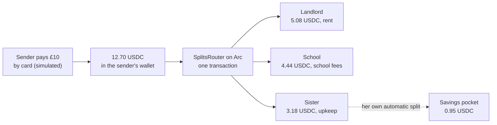

# Splits

Send money home with its purpose built in.

Someone in London supporting family in Lagos rarely sends money for one thing. Part of it is rent, part is a sibling's school fees, the rest is upkeep. Today they either send one lump sum and hope it gets divided the way they meant, or they make several transfers and pay fees on each.

With Splits, the sender sets up a split once: who gets paid, how much, and what for. Every payment through it lands already divided, in one USDC transaction on [Arc](https://arc.io), with an onchain receipt that records what each part was for.

Recipients don't need to install anything. Their email address is their wallet.

## How a payment moves



1. The sender signs in with an email code. A Circle wallet is created for them, and for every recipient named by email.
2. They create a split, for example 40% rent, 35% school fees and 25% upkeep. They approve it with their PIN or Face ID / fingerprint, and it is registered onchain.
3. They send £10. The app shows exactly what each person gets before anything moves.
4. After approval, the app tops up the sender's wallet, approves the exact amount, and calls the router. The router pays every recipient in a single transaction, or pays nobody if any leg fails.
5. The app reads the receipt back from Arc and checks every payout against what the sender approved, before it shows "Delivered".
6. A recipient can set their own automatic split, such as "put 30% of everything I receive into savings". It runs by itself when money arrives.

## Why Arc

- **USDC is the gas token.** Fees are small and in dollars, which matters for a product whose point is avoiding unpredictable transfer costs.
- **Transactions are final when they are included.** "Your family has it" can appear seconds after the sender approves.
- **The split is a contract, not a promise.** Dividing one payment between several people with a purpose attached to each part is a smart contract job. A normal wallet or remittance app doesn't do it.
- **It connects to Circle's stack.** Circle wallets on Arc give email-based accounts with gas paid by the app (Gas Station). CCTP and Circle's onramp give a route from local money in and out of Arc.

## What's in the repo

| Path | What it is |
| --- | --- |
| [`contracts/`](contracts) | `SplitsRouter`, the Solidity contract, with Foundry tests, a mutation check and a fork test against Arc mainnet state |
| [`web/`](web) | The Next.js 16 app. The UI is in `src/app`; the backend (Circle wallets, chain reads, payment state machine) is in `src/server` |
| [`deployments/`](deployments) | The exact contract build used for deployment, and deployment records |

### The contract

[`SplitsRouter.sol`](contracts/src/SplitsRouter.sol) is small on purpose:

- **It never holds money.** USDC goes straight from the payer to each recipient with `transferFrom`. There is no owner, no admin, no fee and no rescue function, so there is nothing to drain and no key that can redirect a payment.
- **All or nothing.** If any recipient can't be paid, for example an address on Arc's blocklist, the whole payment reverts.
- **No double payments.** Each payment carries a reference, and the router refuses to use the same reference twice for the same payer, so a retried request can never pay twice.
- **No surprise edits.** A payment names the split version the sender saw. If the split changed in between, the payment reverts instead of paying the new recipients.
- **Whole cents only.** Each share is rounded down to a cent, and the leftover cent goes to the last share. Nobody is ever paid a fraction of a cent.
- **Purpose receipts.** Every payout emits `LegPaid` with the recipient, the amount and the purpose label.

It is deployed through the standard CREATE2 factory, so testnet and mainnet share one address.

### The app

- **Accounts:** email sign-in with one-time codes. No passwords or seed phrases.
- **Wallets:** [Circle developer-controlled wallets](https://developers.circle.com/wallets/dev-controlled) on Arc, as smart contract accounts, so Circle Gas Station pays the gas.
- **Approvals:** every new split and every payment must be approved with a 6-digit PIN or a passkey (Face ID, fingerprint). Five wrong PINs lock approvals for 15 minutes.
- **Payment engine:** each payment is a resumable state machine: funding, then approval, then sending, then verifying. Every Circle request carries a key derived from the payment, so a retry returns the original transaction instead of sending a second one. A background sweeper finishes payments nobody is watching.
- **Preview mode:** with no keys at all, the app runs against an in-memory copy of Arc and the router that applies the same rules, so anyone can try the full flow.

## Run it

Preview mode needs only Node 22. It uses no keys, no money and no network:

```bash
cd web
npm ci
npm run dev
```

Open http://localhost:3000. Preview mode shows the sign-in code on screen.

Tests:

```bash
cd web && npm test
cd contracts && forge soldeer install && forge test
```

Contract tests that fork Arc need [Arc Foundry](https://github.com/circlefin/arc-foundry) and `--network arc`, because USDC on Arc checks a blocklist precompile that stock Foundry doesn't know about:

```bash
ARC_FORK_RPC=https://rpc.mainnet.arc.io arc-forge test --network arc --match-contract ArcForkTest
```

### Live setup (testnet or mainnet)

1. Copy [`web/.env.example`](web/.env.example) and set `SPLITS_MODE=live` and the network values.
2. Add your Circle API key, then run `node scripts/circle-setup.mjs <env file>`. It registers an entity secret if you don't have one, then creates a wallet set and a treasury wallet. It never prints a secret.
3. Fund the treasury wallet with USDC.
4. Deploy the router with `node scripts/deploy-router.mjs <env file> ../deployments/artifacts/SplitsRouter.json ../deployments`. It checks the deployed code onchain before writing the record.
5. Set `SPLITS_ROUTER_ADDRESS` and start the app.

Live mode won't start with a missing key, a mismatched chain id, or (on mainnet) the testnet-only shortcuts.

## Status

| Part | State |
| --- | --- |
| Contract | Tested: 36 unit and fuzz tests, 11 of 11 deliberate bugs caught by the mutation check, 3 fork tests on Arc mainnet state |
| App, preview mode | Tested: 60 tests, 6 of 6 deliberate bugs caught, an end-to-end API check, and a browser walkthrough at desktop and phone width |
| Arc Testnet deployment | In progress |
| Arc mainnet deployment | Not yet |
| Card payments and currency exchange | Simulated. The card isn't charged and the rate is fixed. The USDC leg is real in live mode. |
| Payout to bank or mobile money | Not built. Recipients hold USDC. |

## Deployments

| Network | SplitsRouter | Record |
| --- | --- | --- |
| Arc Testnet (5042002) | not deployed yet | |
| Arc mainnet (5042) | not deployed yet | |

## Things to know

- **The app holds the keys.** Circle developer-controlled wallets are custodial: the app's Circle account controls the wallets, and the PIN or passkey is the gate before it acts. This is not a non-custodial wallet.
- **Card funding is simulated.** In live mode, a simulated card payment releases real USDC from the app's treasury. Per-payment, per-user and global daily limits cap that spend, and `FUNDING_ENABLED=false` switches it off.
- **Built for the [Arc Microgrants](https://dorahacks.io/hackathon/arc-microgrants/detail) program.** Its scope is one corridor (UK or US to Nigeria) and a working proof, not a licensed money transmitter.
