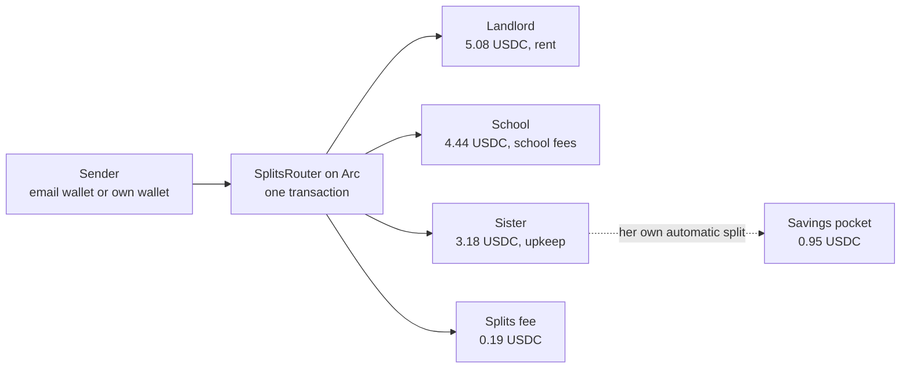
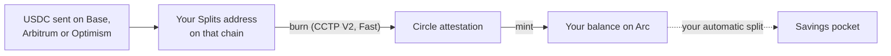
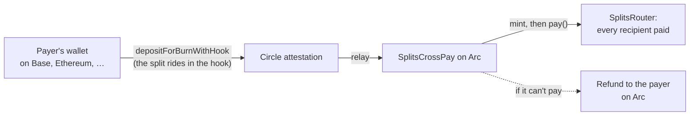

# Splits

Split any payment, to anyone, in one transaction on Arc.

**Live now at [mysplits.xyz](https://mysplits.xyz).** The router contract is
[verified on Sourcify and the Arc explorer](https://explorer.arc.io/address/0x8eDb15a372D3b691E2264fFc897EC53dFF4A64F2?tab=contract).

Splits started with one problem, and it is still the lead example. Someone in London supporting family in Lagos rarely sends money for one thing. Part of it is rent, part is a sibling's school fees, the rest is upkeep. Today they either send one lump sum and hope it gets divided the way they meant, or they make several transfers and pay fees on each.

With Splits, the sender says who gets paid, how much, and what for. The payment lands already divided, in one USDC transaction on [Arc](https://arc.io), with an onchain receipt that records what each part was for.

Recipients don't need to install anything. Their email address is their wallet.

The same engine pays anyone who needs a payment divided: twenty giveaway winners from one pot, a team's revenue share, or one person paid by email or Arc address. Paste the list (or describe it, or drop in a screenshot), check it, approve once, and everyone is paid in a single transaction, or nobody is.

## What you can do today

| | |
| --- | --- |
| **Pay one person or many** | By email or Arc address. Split a pot equally (to the cent) or set each amount. Up to 50 people in one transaction. |
| **Saved splits** | "40% rent, 35% school fees, 25% upkeep", registered onchain once and reused every month. |
| **Pay from another chain** | No USDC on Arc? Pay from Base, Ethereum, Arbitrum, Optimism, Polygon, Avalanche, Unichain or Monad with the same wallet. One burn there, and the split is paid on Arc in the same step that mints the money, or the payer is refunded on Arc. Live on Arc Testnet and mainnet. |
| **Pay without an account** | Open [mysplits.xyz/send](https://mysplits.xyz/send) and pay straight from your own wallet: browser wallets or any WalletConnect wallet. You keep a private status link for the payment. |
| **Describe it, I split it** | Agentic mode: paste rough text ("300 between ada@x.com, 0x12… and Tunde, Tunde gets double") or up to 3 screenshots of a chat or spreadsheet. An agent fills in the list; you check it and pay as usual. |
| **Receipts per person** | Every recipient gets a private receipt showing only their part and what it was for. The sender chooses whose receipt to share. |
| **Automatic splits** | A recipient can divide what they receive, such as "30% of everything into savings". It runs by itself when money arrives, deposits included. |
| **Add money from other chains** | Your Splits address is the same on Arc, Base, Ethereum, Arbitrum, Optimism, Polygon, Avalanche, Unichain and Monad. Send USDC to it from any of them and it lands in your Arc balance by itself, moved with Circle's CCTP. |
| **Notifications** | A bell for everything that happens to your money (deposits arriving and ready, payments landed or failed, money received), with the moments that matter also by email. Clear them any time. |
| **History** | Money in and out, each with its receipt, paged. Home shows the latest few. |

## How a payment moves



1. **Check.** The list is read before anything moves: duplicates, your own wallet, malformed lines and addresses that can't receive USDC right now (a free simulated 1-cent transfer) are marked, and the list can't be approved until they're fixed. The screen shows exactly what each person gets, the Splits fee and the total.
2. **Approve.** Signed-in senders approve with a 6-digit PIN or a passkey (Face ID, fingerprint). Senders without an account approve in their own wallet: the exact total, then the payment.
3. **Pay.** The router pays every recipient in one transaction, or nobody if any leg fails. Each person's part is a `LegPaid` event with its purpose.
4. **Verify.** The app reads the receipt back from Arc and checks every payout against what was approved before it says "Landed".
5. **Tell.** People paid by email get a "you received money" email and find it in their balance when they sign in.

An equal pot is split to the cent: $100 across 7 winners pays four of them $14.29 and three $14.28.

## Adding money from other chains



Circle wallets keep the same address on every EVM chain, so the person's Arc address is also their deposit address on Base, Ethereum, Arbitrum, Optimism, Polygon, Avalanche, Unichain and Monad. When USDC arrives there:

1. **It is checked on its own chain** before it counts: the receipt must show a USDC transfer to that address. A webhook or a list from Circle is a hint, never the truth.
2. **Nothing is missed.** Circle's webhook is the fast path, a sweeper polls as a backup, and the chain balance itself is the final check: money that no reported transfer explains (sent before the address was set up, or a lost webhook) is found after two minutes and moved too, and counted once if Circle reports it later.
3. **It is moved to Arc** with CCTP V2: approve and burn from the person's wallet (gas paid by Gas Station), Circle attests, and the app's treasury mints on Arc. Every step carries a key derived from the move, so a crash or retry resumes the same transaction; a mint only counts once Arc marks its message used; and a failing step backs off instead of retrying forever.
4. **The person is told** when it arrives and when it is ready, and their automatic split runs on it.

Deposits under $1 wait until there is enough to move ($20 on Ethereum, where moving costs more). Proven end to end on testnet from Base, Arbitrum and Optimism; all eight chains are switched on for mainnet.

## Paying from another chain



A visitor's USDC doesn't have to be on Arc. They pick the chain it's on, see the whole cost (the split, the Splits fee, Circle's fee at its most and their own network fee), and confirm once or twice in their wallet there. Nothing is signed on Arc.

1. **One burn on their chain.** CCTP's `depositForBurnWithHook` names [`SplitsCrossPay`](contracts/src/SplitsCrossPay.sol) as both the only address that may receive the mint and the only one that may complete it, and carries the split in its hook data. Fast Transfer where the chain offers it; the payer covers Circle's fee, so recipients get exactly the split.
2. **Checked where it happened.** The server reads the burn on the chain the payer chose, and trusts it only if the amount, the recipient, the caller and the hook all match the payment.
3. **Paid in the mint.** Once Circle attests, the treasury relays it. In one Arc transaction the contract mints, pays every recipient through `SplitsRouter.pay`, and sends any unused part of Circle's fee back to the payer.
4. **Refunded if it can't pay.** If a recipient can't receive, everything minted goes back to the payer on Arc; if even that is refused, it is held for them to claim. The contract has no owner and keeps nothing for itself.

Slow wallets, sped-up transactions, a closed page, a second burn for the same payment, an expired attestation and an unreachable chain each have a defined outcome and a plain message.

## Why Arc

- **USDC is the gas token.** Fees are small and in dollars, which matters for a product whose point is avoiding unpredictable transfer costs. Paying 10 people costs about a cent of gas.
- **Transactions are final when they are included.** "Your family has it" appears seconds after the sender approves.
- **The split is a contract, not a promise.** Dividing one payment between several people with a purpose attached to each part is a smart contract job. A normal wallet or remittance app doesn't do it.
- **It connects to Circle's stack.** Circle wallets on Arc give email-based accounts whose gas the app pays through Gas Station. Circle's App Kit gives the routes in and out of local money (see the roadmap).

## The contract

[`SplitsRouter.sol`](contracts/src/SplitsRouter.sol) is small on purpose:

- **It never holds money.** USDC goes straight from the payer to each recipient with `transferFrom`. There is no owner, no admin and no rescue function, so there is nothing to drain and no key that can redirect a payment.
- **All or nothing.** If any recipient can't be paid, for example an address on Arc's blocklist, the whole payment reverts.
- **No double payments.** Each payment carries a reference, and the router refuses the same reference twice from the same payer, so a retried request can never pay twice.
- **No fee logic.** The Splits fee is set by the app and travels as one more leg in the same transaction, visible to the payer before they approve. The contract treats it like any other recipient.
- **One-off and saved splits.** `pay(legs, amount, ref)` pays a list once without storing it. Saved splits are versioned: a payment names the version the sender saw, and reverts if the split changed in between.
- **Whole cents only.** Nobody is ever paid a fraction of a cent.
- **No recipient limit in the contract.** One transaction's gas is the real limit: measured on a mainnet fork at 49,160 gas per recipient, so the app allows at most 300 and defaults to 50.

It is deployed through the standard CREATE2 factory, so testnet and mainnet share one address.

## The app

- **Accounts:** email sign-in with one-time codes. No passwords or seed phrases.
- **Wallets:** [Circle developer-controlled wallets](https://developers.circle.com/wallets/dev-controlled) on Arc, as smart contract accounts, with gas sponsored by Circle Gas Station.
- **Paying from your own wallet:** [Reown AppKit](https://reown.com/appkit) with browser wallets and WalletConnect, loaded only on the pages that need it. The payment is reserved for 30 minutes and verified onchain by its reference, so a closed tab or a slow wallet never loses or doubles a payment.
- **Splits fee:** 1.5% (2% from 10 recipients), paid by the sender on top and shown before approval. Set by the server's settings, fixed per payment when it is quoted, and never in the contract.
- **Send limit:** until identity verification is added, nobody sends more than 500 USDC per payment or per rolling 24 hours, fee included. Visitors without an account have the same limit, tracked by wallet and email.
- **Agentic mode:** signed-in only, 20 drafts a day per account and a global hourly cap. The agent can only fill the list form: it never sees balances and never pays. Pasted text and screenshots are never stored or logged.
- **Deposits from other chains:** see above. The chains are switched on per server (`DEPOSIT_CHAINS`), and each is checked against its CCTP contract when the server starts.
- **Notifications:** in the app for everything, by email for the moments that matter (with a switch in Settings). Emails carry the Splits logo and are sent through Resend.
- **Reading Arc:** through our own Arc node first, with Arc's public RPC as fallback. Every 30 seconds the app compares block heights and passes over any RPC that has fallen behind, so a lagging node can never show an old balance.
- **Payment engine:** each payment is a resumable state machine. Every Circle request carries a key derived from the payment, so a retry returns the original transaction instead of sending a second one. A background sweeper finishes payments nobody is watching.
- **Preview mode:** with no keys at all, the app runs against an in-memory copy of Arc and the router that applies the same rules, so anyone can try the full flow.

## Repo

| Path | What it is |
| --- | --- |
| [`contracts/`](contracts) | `SplitsRouter` with Foundry tests, a mutation check and fork tests against Arc mainnet state |
| [`web/`](web) | The Next.js 16 app. UI in `src/app`; backend (Circle wallets, chain reads, payment engine, agentic mode) in `src/server` |
| [`deploy/`](deploy) | Production: Docker Compose (app and Postgres), the deploy script with automatic rollback |
| [`.github/workflows/deploy.yml`](.github/workflows/deploy.yml) | One push to `main` tests, builds and deploys |
| [`deployments/`](deployments) | The exact contract build used for deployment, and deployment records |

## Run it

Preview mode needs only Node 22. It uses no keys, no money and no network:

```bash
cd web
npm ci
npm run dev
```

Open http://localhost:3000. Preview mode shows the sign-in code on screen, and agentic mode uses a built-in stand-in instead of the live agent.

Tests:

```bash
cd web && npm test
cd contracts && forge soldeer install && forge test
```

Fork tests need [Arc Foundry](https://github.com/circlefin/arc-foundry), because USDC on Arc checks a blocklist precompile that stock Foundry doesn't know about:

```bash
ARC_FORK_RPC=https://rpc.mainnet.arc.io arc-forge test --network arc --match-contract ArcForkTest
```

### Production

Every push to `main` runs the [deploy workflow](.github/workflows/deploy.yml): typecheck, the full test suite and a build (the contract compiled with the checksum-pinned Arc Foundry), then a Docker image. The image is copied to the server, started next to its own Postgres, and kept only if it reports healthy within two minutes; otherwise the previous release is restored. A database dump is taken before every release. Details are in [`deploy/README.md`](deploy/README.md).

To run your own: copy [`web/.env.example`](web/.env.example), add a Circle API key, run `node scripts/circle-setup.mjs <env file>` (it creates the wallet set and treasury wallet and never prints a secret), activate a Gas Station policy for Arc, and deploy the router with `node scripts/deploy-router.mjs <env file> ../deployments/artifacts/SplitsRouter.json ../deployments`, which checks the deployed code onchain before writing the record. Live mode won't start with a missing key, a mismatched chain id, or testnet-only shortcuts on mainnet.

## Status

| Part | State |
| --- | --- |
| Contract | `SplitsRouter`: 46 unit and fuzz tests; 14 of 14 deliberate bugs caught by the mutation check; 5 fork tests on Arc mainnet state, including the gas measurement and a plain wallet paying through the router. Verified (exact match) on Sourcify and the Arc explorer. `SplitsCrossPay`: 32 unit tests, a 20,000-run fuzz test, an invariant (the contract only ever holds refunds it owes) and 3 fork tests, one of which relays at every gas limit near the edge and finds none that turns a payment into a refund; 4 of 4 deliberate bugs caught; reviewed three times, the last in the [2026-10-28 audit](docs/audits/2026-10-28-full-audit.md); deployed with that audit's fixes on Arc Testnet and mainnet, and verified (exact match) on Sourcify. |
| App | 417 tests, run on both PGlite and Postgres; 79 of 79 deliberate bugs caught by the mutation check; an end-to-end API check over real HTTP (including a deposit from Base reaching the balance); the production image started and checked healthy, with its logo served, before release. |
| Pay from another chain | Live on Arc Testnet with all eight chains switched on: a payment from Base Sepolia paid three people on Arc in [one relay](https://explorer.testnet.arc.io/tx/0xa0a830ccae5ebc5ccdbc439f51d5bd31aac67f8419938e5a0ee3d2cbc68ac13f), with the unused part of Circle's fee sent back to the payer. Every failure case is tested in preview and the contract against Arc mainnet state. Live on mainnet with the same eight chains. |
| Deposits from other chains | Live on testnet from Base, Arbitrum and Optimism (three real deposits each, all moved to Arc). On mainnet all eight chains are switched on, each with its own Gas Station policy. |
| Arc mainnet | Live at [mysplits.xyz](https://mysplits.xyz), deployed by the workflow above. |
| Arc Testnet | Live staging, used for every change before mainnet. |
| Earning pocket (Arc Earn Kit) | Live on testnet behind a switch: money moved in, put in the vault and brought back on Arc Testnet. Off on mainnet. See the roadmap. |
| Card checkout (onramp) | Simulated on testnet; switched off on mainnet. See the roadmap. |
| Cash-out to bank or mobile money (offramp) | Not built. Shown in the app as "Coming soon"; recipients hold USDC. |

## Deployments

| Network | SplitsRouter | SplitsCrossPay | Record |
| --- | --- | --- | --- |
| Arc mainnet (5042) | [`0x8eDb15a372D3b691E2264fFc897EC53dFF4A64F2`](https://explorer.arc.io/address/0x8eDb15a372D3b691E2264fFc897EC53dFF4A64F2) | [`0xf7b93B07296bEEaE73060A70Ef5F1b07Da7f1ec1`](https://explorer.arc.io/address/0xf7b93B07296bEEaE73060A70Ef5F1b07Da7f1ec1) | [`arc-mainnet.json`](deployments/arc-mainnet.json) |
| Arc Testnet (5042002) | [`0x8eDb15a372D3b691E2264fFc897EC53dFF4A64F2`](https://explorer.testnet.arc.io/address/0x8eDb15a372D3b691E2264fFc897EC53dFF4A64F2) | [`0x2BC1a255672e7cf8Dd09e77Fe8dD0a0962aE2116`](https://explorer.testnet.arc.io/address/0x2BC1a255672e7cf8Dd09e77Fe8dD0a0962aE2116) | [`arc-testnet.json`](deployments/arc-testnet.json) |

The mainnet router was deployed in [`0x4e6e…750f`](https://explorer.arc.io/tx/0x4e6ec03354f5e5c6cb0ffe5d2010af145a3443e02bffe230be5a0ef282bc750f) from the app's Circle treasury wallet, with gas paid by Gas Station.

The first payment on mainnet split $0.03 between three addresses from an email account's wallet, approved with a PIN, in [one transaction](https://explorer.arc.io/tx/0x3bdef0852fbf7493e030b1affec7f9b34e42f8937dc179e05d112a83828a28c2): one `SplitSent` and three `LegPaid` receipts, with about $0.007 of gas paid by Gas Station.

The first live giveaway on testnet paid 20 people, 15 Arc addresses and 5 email recipients, 0.10 USDC each from a 2.00 pot, in [one transaction](https://explorer.testnet.arc.io/tx/0x70ffeac219fdcaf6b29a56eb1dc56687b9149cee46714626d8330606adf4ccc2): one `SplitSent` with split id 0 and 20 `LegPaid` receipts, each marked "giveaway prize".

## Roadmap

Splits on mainnet today is a working proof of concept. It proves the core idea with real USDC: one payment divided between many people, with the purpose of each part recorded on Arc, in a single transaction. The roadmap takes it from an app people use to infrastructure other products build on.

Each item is designed and built the same way as everything above: a written design, a plan, tests first, a fresh review, then staging before mainnet.

### 1. Onramp: pay by card, Apple Pay, Google Pay or bank transfer

Today a sender needs USDC, in their Splits balance or in their own wallet. With [Arc App Kit Onramp](https://docs.arc.io/app-kit/onramp) (`@circle-fin/onramp-kit`), a sender in London pays by card, Apple Pay, Google Pay or bank transfer, and the USDC lands directly in their Splits wallet on Arc, ready to be split. It stays behind a switch until Circle's business verification (KYB) for Splits clears, and the simulated card on testnet is replaced by it.

### 2. Offramp: cash out to a bank or mobile money

Recipients hold USDC today. The next step is letting the sister in Lagos turn her part into naira in her bank account or mobile money wallet, through a licensed payout partner, from the same balance screen where "Bank or mobile money" now says "Coming soon". A split can then end in local money, not only in a wallet.

### 3. Earning pocket with Arc Earn Kit

Money that sits in a Splits balance between payments could earn. The opt-in **Earning pocket** uses [Arc Earn Kit](https://docs.arc.io/app-kit/earn) (`@circle-fin/earn-kit`, lending through Morpho vaults on Arc). It is built and running on Arc Testnet behind a switch:

- Off by default. Turning it on shows the vault, the current rate, that it is variable and not guaranteed, and how to move money back.
- Works with automatic splits: "30% of everything I receive goes to my Earning pocket". Whatever lands in the pocket is put in the vault on its own.
- Money moves in and out with the same PIN or passkey approval as a payment, with no Splits fee. Moving out comes back to the spendable balance.
- On mainnet Splits only offers a vault Circle has vetted, with enough money in it to pay people out. Any other vault keeps the pocket switched off. Arc Testnet has no Circle-vetted vault, so staging relaxes the vetting check, and the app refuses to start on mainnet with it relaxed. On testnet, a full run moved $1.20 in, [put it in the vault](https://explorer.testnet.arc.io/tx/0x28bbfc2c55a5fad0edc06d8b6895704c5c9c1af760f10a5c7a3fcca88b9373bb) and [brought all of it back](https://explorer.testnet.arc.io/tx/0xd097a2bf53280148badfb3dbad3a94702e26f811afd7b6fbb33dfe20f53c8e2f).
- On mainnet it will use Steakhouse Prime USDC, a Circle-vetted vault, once a small real deposit has been checked end to end.

### 4. Splits for developers and agents: an API and an MCP server

The engine behind the app checks a list, quotes the fee, pays everyone in one transaction and verifies the receipt on Arc. The same engine can work inside other products:

- **Developer API.** Fintech, payroll and remittance apps create, check and send splits for their own users, and follow each payment to "Landed" with webhooks. They get divided payments and per-person receipts without building the contract or the payment engine themselves.
- **MCP server.** AI agents and assistants (Claude, ChatGPT, agent frameworks) can draft a split from a conversation, check it and show the person exactly who gets what and the fee. The payment only goes out after the person approves it. This keeps the rule agentic mode follows today: the agent fills in the list, and only the person can pay.
- **The same guarantees everywhere.** Everyone is paid in one transaction or nobody is, each part keeps its purpose onchain, and the same limits apply.

Dividing a payment then becomes a building block that any payment flow can call, with programmable USDC on Arc underneath.

### Also planned

- **Usernames:** pay `@tunde` instead of an email or address. Already recognised in lists, where they show "coming soon".
- **Identity verification in the profile,** with names moving from sign-up to the profile, to raise the 500 USDC limit.
- **Google sign-in,** landing on the same email account.
- **Solana deposits,** and more CCTP chains as their Gas Station support arrives.

## Things to know

- **The app holds the keys for email wallets.** Circle developer-controlled wallets are custodial: the app's Circle account controls them, and the PIN or passkey is the gate before it acts. People who want to keep their own keys can pay from their own wallet at [/send](https://mysplits.xyz/send).
- **The app pays the gas for email wallets** through Circle Gas Station, within daily limits set in the Circle console.
- **Built for the [Arc Microgrants](https://dorahacks.io/hackathon/arc-microgrants/detail) program.** It is a working product on mainnet with a 500 USDC send limit, not yet a licensed money transmitter; the limit stays until identity verification is in place.
